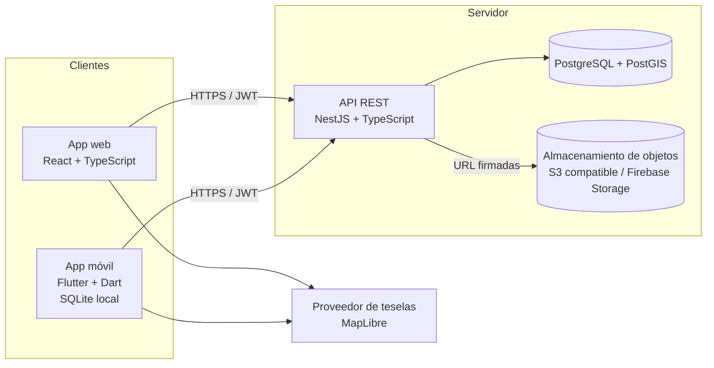
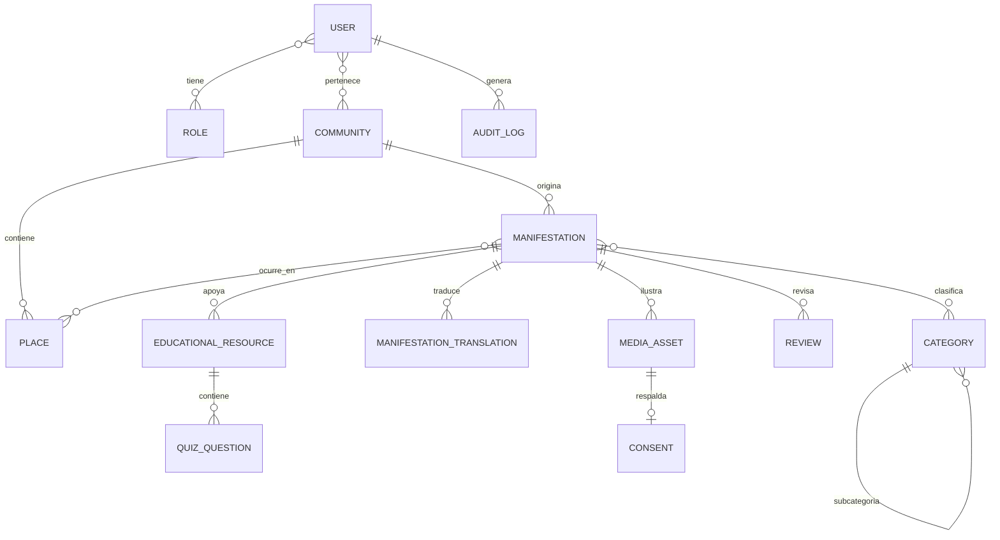
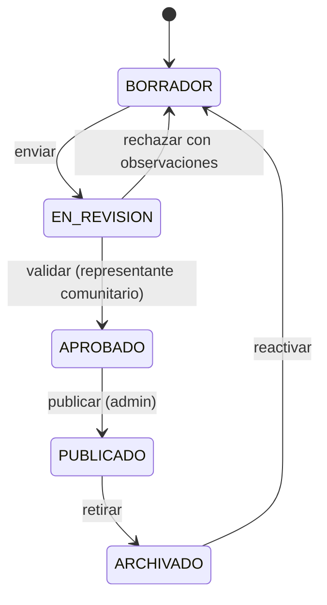

# SPEC — Kallarimanta Digital

Especificación técnica de la arquitectura multiplataforma web y móvil para la gestión, georreferenciación y difusión educativa del patrimonio cultural inmaterial Kichwa de la Sierra Sur del Ecuador.

| Campo | Valor |
|---|---|
| Código institucional | ITI-TFG-B26-0027 |
| Carrera | Ingeniería en Tecnologías de la Información — UTI |
| Organización beneficiaria | Universidad Tecnológica Indoamérica — Centro de Investigación de Ciencias Humanas y de la Educación (CICHE) |
| Proyecto marco | Kallarimanta |
| Autor | Michael Jhosue Almeida Díaz |
| Tutor | Pablo Alejandro Quezada Sarmiento, PhD. |
| Línea / sublínea | 4.1 — Diseño y desarrollo de aplicaciones web |
| Versión del documento | 0.1 (borrador) |
| Estado | En revisión |

---

## 1. Resumen

Kallarimanta Digital es una solución compuesta por:

1. **Aplicación web administrativa** para registrar, clasificar, validar y publicar manifestaciones culturales, comunidades, ubicaciones y contenidos multimedia.
2. **Aplicación móvil multiplataforma** (prioridad Android) para consultar contenidos culturales y educativos, explorar mapas y acceder a contenidos descargados sin conexión.
3. **API de servicios** que centraliza las reglas de negocio, la seguridad y el acceso a los datos.
4. **Base de datos espacial** y **repositorio multimedia**.

La primera versión es un **prototipo funcional** aplicado a una muestra de comunidades y manifestaciones del proyecto Kallarimanta, diseñado para crecer en comunidades, categorías e idiomas.

---

## 2. Objetivos y trazabilidad

**Objetivo general.** Desarrollar una arquitectura multiplataforma web y móvil que permita gestionar, georreferenciar y difundir con fines educativos el patrimonio cultural inmaterial de los pueblos Kichwa de la Sierra Sur del Ecuador.

| ID | Objetivo específico | Secciones de este SPEC |
|---|---|---|
| OE1 | Identificar y analizar requerimientos funcionales, no funcionales, educativos y culturales | §4, §5, §6 |
| OE2 | Diseñar la arquitectura, el modelo de datos y las interfaces | §7, §8, §9, §14 |
| OE3 | Desarrollar la aplicación web administrativa | §5 (RF-01 a RF-09, RF-13), §11 |
| OE4 | Implementar la aplicación móvil multiplataforma | §5 (RF-10 a RF-12), §12 |
| OE5 | Integrar el módulo de georreferenciación | §5 (RF-06), §9, §13 |

---

## 3. Alcance

### 3.1 Incluido

- Autenticación y administración de usuarios por roles.
- Gestión de comunidades, categorías culturales y manifestaciones del patrimonio.
- Carga y almacenamiento de fotografías, audios, videos y documentos.
- Clasificación por comunidad, categoría y ubicación.
- Georreferenciación y mapas interactivos.
- Buscador con filtros.
- Flujo de revisión y validación antes de publicar.
- Recursos educativos: fichas, cuestionarios y contenidos interactivos.
- Interfaz adaptable a móviles y escritorio.
- Consulta sin conexión de contenidos descargados (app móvil).
- Contenidos en español y, cuando estén validados, en kichwa.
- Reportes básicos.

### 3.2 Excluido

- Versiones nativas independientes por sistema operativo (se usa Flutter; iOS queda condicionado a compatibilidad).
- Digitalización exhaustiva de todo el patrimonio de la Sierra Sur.
- Publicación de conocimiento sagrado, reservado o sensible sin autorización de sus portadores.
- Traducción automática al kichwa sin revisión lingüística y cultural.
- Arquitectura de microservicios.
- Realidad aumentada, analítica avanzada y edición colaborativa abierta (trabajo futuro).

---

## 4. Usuarios y roles

| Rol | Descripción | Canal principal |
|---|---|---|
| `ADMIN` | Administra usuarios, roles, catálogos y configuración | Web |
| `INVESTIGADOR` | Registra y documenta manifestaciones; propone contenidos | Web |
| `EDITOR` | Edita y organiza contenidos y recursos multimedia | Web |
| `REPRESENTANTE_COMUNITARIO` | Revisa y valida contenidos de su comunidad; define restricciones | Web |
| `DOCENTE` | Crea y consulta recursos educativos | Web / Móvil |
| `ESTUDIANTE` | Consulta contenidos y resuelve actividades | Móvil / Web |
| `VISITANTE` | Consulta contenido público sin cuenta | Móvil / Web |

### 4.1 Matriz de permisos

| Acción | ADMIN | INVEST. | EDITOR | REP. COM. | DOCENTE | ESTUD. | VISIT. |
|---|:-:|:-:|:-:|:-:|:-:|:-:|:-:|
| Gestionar usuarios y roles | ✔ | | | | | | |
| Gestionar comunidades y categorías | ✔ | | ✔ | | | | |
| Crear / editar manifestación (borrador) | ✔ | ✔ | ✔ | | | | |
| Cargar multimedia | ✔ | ✔ | ✔ | ✔ | | | |
| Enviar a revisión | ✔ | ✔ | ✔ | | | | |
| Validar / rechazar contenido | ✔ | | | ✔ (su comunidad) | | | |
| Publicar | ✔ | | | | | | |
| Definir nivel de acceso | ✔ | | | ✔ (su comunidad) | | | |
| Crear recursos educativos | ✔ | ✔ | ✔ | | ✔ | | |
| Ver contenido `PUBLICO` | ✔ | ✔ | ✔ | ✔ | ✔ | ✔ | ✔ |
| Ver contenido `RESTRINGIDO` | ✔ | ✔ | ✔ | ✔ | ✔ | | |
| Ver contenido `RESERVADO` | ✔ | | | ✔ (su comunidad) | | | |
| Ver reportes | ✔ | ✔ | | | | | |

---

## 5. Requisitos funcionales

Prioridad: **M** = obligatorio en el prototipo, **D** = deseable.

| ID | Módulo | Requisito | Prioridad |
|---|---|---|:-:|
| RF-01 | Autenticación | Iniciar y cerrar sesión con correo y contraseña; emitir JWT de acceso y token de renovación | M |
| RF-02 | Usuarios | CRUD de usuarios, asignación de roles y asociación a comunidades | M |
| RF-03 | Comunidades | CRUD de comunidades con nombre, pueblo, cantón, provincia, descripción y ubicación | M |
| RF-04 | Categorías | CRUD de categorías culturales jerárquicas (p. ej. Gastronomía, Festividades, Medicina ancestral, Música y danza, Lengua, Tradición oral, Técnicas artesanales, Prácticas productivas, Sistemas simbólicos) | M |
| RF-05 | Manifestaciones | Registrar, editar y archivar manifestaciones con título, descripción, comunidad, categorías, palabras clave, autoría, fuente, fecha y nivel de acceso | M |
| RF-06 | Georreferenciación | Registrar un punto o polígono por comunidad, lugar o manifestación; mostrarlos en un mapa con agrupación de marcadores y consultas por proximidad | M |
| RF-07 | Multimedia | Cargar fotografías, audios, videos y documentos; validar formato y tamaño; generar miniaturas y versiones optimizadas | M |
| RF-08 | Validación | Flujo `BORRADOR → EN_REVISION → APROBADO → PUBLICADO` con rechazo y observaciones (§10) | M |
| RF-09 | Búsqueda | Búsqueda por texto y filtros por comunidad, categoría, tipo de contenido e idioma | M |
| RF-10 | Consulta móvil | Listar, ver detalle y reproducir contenidos publicados en la app móvil | M |
| RF-11 | Mapa móvil | Explorar comunidades y manifestaciones en un mapa interactivo y abrir su ficha | M |
| RF-12 | Sin conexión | Descargar fichas, textos, imágenes optimizadas y ubicaciones para consulta sin Internet; sincronizar al recuperar conexión (§12) | M |
| RF-13 | Recursos educativos | Crear fichas informativas y cuestionarios vinculados a manifestaciones; resolverlos en la app | M |
| RF-14 | Bilingüe | Cada texto admite versión en español y kichwa; la versión kichwa solo se publica si está validada | M |
| RF-15 | Reportes | Panel con totales de usuarios, comunidades, manifestaciones por estado y categoría, y contenidos más consultados | M |
| RF-16 | Consentimiento | Registrar el consentimiento y la autoría de cada recurso antes de su publicación | M |
| RF-17 | Auditoría | Registrar acciones relevantes (creación, cambios de estado, publicación, eliminación) | M |
| RF-18 | Favoritos | Guardar contenidos favoritos en la app móvil | D |
| RF-19 | Solicitudes | Permitir que una comunidad solicite corregir, restringir o retirar un contenido | D |

---

## 6. Requisitos no funcionales

| ID | Atributo | Requisito |
|---|---|---|
| RNF-01 | Usabilidad | Navegación clara para usuarios con poca experiencia digital; SUS ≥ 68 en la evaluación con usuarios |
| RNF-02 | Accesibilidad | Contraste y tamaños conforme a WCAG 2.1 AA en lo aplicable; textos alternativos en imágenes; transcripción o descripción en audios cuando exista |
| RNF-03 | Seguridad | HTTPS obligatorio; contraseñas con hash (bcrypt o argon2); autorización por rol en cada endpoint; validación de archivos |
| RNF-04 | Rendimiento | Respuesta de la API p95 < 500 ms en consultas de listado con paginación; imágenes servidas en versión optimizada |
| RNF-05 | Conectividad limitada | La app móvil funciona sin red para contenidos descargados; las descargas son incrementales |
| RNF-06 | Compatibilidad | Android 8.0 (API 26) o superior; web en las dos últimas versiones de Chrome, Firefox y Edge |
| RNF-07 | Escalabilidad | Nuevas comunidades, categorías e idiomas se agregan sin cambiar el esquema |
| RNF-08 | Mantenibilidad | Backend organizado en módulos; API documentada con OpenAPI; cobertura de pruebas del backend ≥ 60 % |
| RNF-09 | Disponibilidad | Copias de seguridad diarias de la base de datos y del repositorio multimedia |
| RNF-10 | Protección de datos | Cumplimiento de la Ley Orgánica de Protección de Datos Personales del Ecuador y de las políticas institucionales |
| RNF-11 | Pertinencia cultural | Ningún contenido se publica sin validación; los lugares sensibles se muestran con ubicación aproximada |
| RNF-12 | Portabilidad | Despliegue reproducible con Docker Compose |

---

## 7. Arquitectura

Arquitectura cliente-servidor con un **monolito modular** en el backend.



### 7.1 Módulos del backend

| Módulo | Responsabilidad |
|---|---|
| `auth` | Inicio de sesión, JWT, renovación de tokens, guardas de rol |
| `users` | Usuarios, roles y asociación a comunidades |
| `communities` | Comunidades y su ubicación |
| `categories` | Catálogo jerárquico de categorías culturales |
| `manifestations` | Manifestaciones, traducciones, estados y niveles de acceso |
| `media` | Carga, validación, optimización y URL firmadas |
| `geo` | Consultas espaciales y entrega de GeoJSON |
| `review` | Flujo de validación y observaciones |
| `education` | Fichas y cuestionarios |
| `search` | Búsqueda de texto completo y filtros |
| `sync` | Paquetes de descarga y cambios incrementales para la app móvil |
| `reports` | Indicadores del panel |
| `audit` | Registro de actividades |

---

## 8. Pila tecnológica

| Componente | Tecnología |
|---|---|
| Aplicación web | React + TypeScript (Vite) |
| Aplicación móvil | Flutter + Dart |
| Backend | Node.js + NestJS + TypeScript |
| API | REST documentada con OpenAPI / Swagger |
| Base de datos | PostgreSQL |
| Información geográfica | PostGIS |
| Mapas | MapLibre (GL JS en web, plugin de Flutter en móvil) |
| Almacenamiento local | SQLite |
| Archivos multimedia | Almacenamiento de objetos compatible con S3 o Firebase Cloud Storage |
| Autenticación | JSON Web Token (JWT) |
| Diseño de interfaces | Figma |
| Control de versiones | Git + GitHub |
| Contenedores | Docker + Docker Compose |
| Integración continua | GitHub Actions |
| Pruebas | Jest, Flutter Test, Postman y pruebas de usabilidad (SUS) |

---

## 9. Modelo de datos



### 9.1 Entidades principales

| Entidad | Campos clave |
|---|---|
| `user` | id, nombre, correo, hash_contraseña, activo, creado_en |
| `role` | id, código (`ADMIN`, `INVESTIGADOR`…) |
| `community` | id, nombre, pueblo, provincia, cantón, parroquia, descripción, `geom` (Point) |
| `place` | id, community_id, nombre, tipo, sensible (bool), `geom` (Point/Polygon), `geom_publica` (Point aproximado) |
| `category` | id, parent_id, nombre_es, nombre_kichwa, slug |
| `manifestation` | id, community_id, estado, nivel_acceso, autoría, fuente, fecha_registro, palabras_clave, creado_por, publicado_en |
| `manifestation_translation` | manifestation_id, idioma (`es`, `qu`), título, descripción, validada (bool) |
| `media_asset` | id, manifestation_id, tipo (`IMAGEN`, `AUDIO`, `VIDEO`, `DOCUMENTO`), clave_objeto, mime, tamaño, duración, autoría, nivel_acceso |
| `consent` | id, media_asset_id, otorgado_por, fecha, alcance, documento_clave |
| `review` | id, manifestation_id, revisor_id, decisión, observaciones, fecha |
| `educational_resource` | id, manifestation_id, tipo (`FICHA`, `CUESTIONARIO`), título, contenido |
| `quiz_question` | id, resource_id, enunciado, opciones (JSONB), respuesta_correcta |
| `audit_log` | id, user_id, acción, entidad, entidad_id, datos (JSONB), fecha |

**Convenciones:** SRID 4326 para geometrías, índices GiST sobre `geom`, índice GIN de texto completo sobre título, descripción y palabras clave, y columna `actualizado_en` en todas las tablas (la usa la sincronización).

---

## 10. Flujo de validación y niveles de acceso



| Nivel de acceso | Quién lo ve |
|---|---|
| `PUBLICO` | Cualquier usuario, incluido el visitante; se puede descargar para uso sin conexión |
| `RESTRINGIDO` | Usuarios autenticados con rol institucional |
| `RESERVADO` | Solo el administrador y los representantes de la comunidad de origen; nunca se descarga ni se publica |

**Reglas:**
- Una manifestación no pasa a `PUBLICADO` si alguno de sus recursos multimedia no tiene consentimiento registrado.
- La traducción al kichwa solo se muestra si `validada = true`.
- Un lugar con `sensible = true` expone únicamente `geom_publica` (precisión reducida, por ejemplo redondeada a unos 1 km) a usuarios sin permiso.

---

## 11. API REST (resumen)

Prefijo `/api/v1`. Las respuestas paginadas usan `?page=&limit=`. La documentación se publica en `/api/docs`.

| Método | Ruta | Descripción | Rol mínimo |
|---|---|---|---|
| POST | `/auth/login` | Inicio de sesión | — |
| POST | `/auth/refresh` | Renovar token | — |
| GET/POST/PATCH/DELETE | `/users` | Gestión de usuarios | ADMIN |
| GET | `/communities` | Listar comunidades | — |
| POST/PATCH/DELETE | `/communities/:id` | Gestionar comunidades | ADMIN, EDITOR |
| GET | `/categories` | Árbol de categorías | — |
| GET | `/manifestations` | Listar con filtros (`community`, `category`, `type`, `lang`, `q`) | — (según nivel de acceso) |
| POST/PATCH | `/manifestations/:id` | Crear o editar | INVESTIGADOR, EDITOR |
| POST | `/manifestations/:id/submit` | Enviar a revisión | INVESTIGADOR, EDITOR |
| POST | `/manifestations/:id/review` | Aprobar o rechazar | REPRESENTANTE_COMUNITARIO |
| POST | `/manifestations/:id/publish` | Publicar | ADMIN |
| POST | `/media/upload-url` | Obtener URL firmada de carga | INVESTIGADOR, EDITOR, REP. COM. |
| POST | `/media/:id/consent` | Registrar consentimiento | INVESTIGADOR, EDITOR |
| GET | `/geo/features` | GeoJSON por `bbox` y filtros | — |
| GET | `/geo/nearby` | Manifestaciones cercanas (`lat`, `lng`, `radius`) | — |
| GET/POST | `/education/resources` | Fichas y cuestionarios | DOCENTE (escritura) |
| GET | `/search` | Búsqueda de texto completo | — |
| GET | `/sync/changes?since=` | Cambios incrementales para la app móvil | — |
| GET | `/reports/summary` | Indicadores del panel | ADMIN, INVESTIGADOR |

---

## 12. Funcionamiento sin conexión (app móvil)

- **Enfoque:** *offline-first* de solo lectura. La app lee siempre desde SQLite y sincroniza en segundo plano.
- **Qué se descarga:** solo contenido `PUBLICO` y `PUBLICADO`, con fichas, textos, imágenes optimizadas, ubicaciones y recursos educativos. Los videos se descargan solo si el usuario lo pide.
- **Sincronización:** `GET /sync/changes?since=<timestamp>` devuelve altas, cambios y bajas. El cliente guarda la marca de la última sincronización.
- **Conflictos:** no aplica en el prototipo, porque la app móvil no edita contenido. Siempre gana el servidor.
- **Almacenamiento:** el usuario elige qué comunidades o categorías descargar y ve cuánto espacio ocupan.
- **Mapas sin conexión:** decisión abierta (§19).

---

## 13. Seguridad y ética

- JWT de acceso de corta duración (15 min) y token de renovación (7 días) revocable.
- Guardas de rol y de comunidad en el backend. La interfaz oculta acciones, pero nunca es la única barrera.
- Archivos: lista blanca de MIME, límite de tamaño por tipo (imagen 10 MB, audio 50 MB, video 200 MB y documento 20 MB, ajustables) y nombres generados por el servidor.
- URL firmadas de corta duración para contenidos `RESTRINGIDO`.
- Registro de auditoría para cambios de estado y de nivel de acceso.
- Consentimiento informado y autoría registrados por recurso.
- Ubicación aproximada para lugares ceremoniales, sagrados o sensibles.
- Mecanismo para que la comunidad solicite corregir, restringir o retirar contenido (RF-19).
- Principios de referencia: protocolos culturales de acceso y soberanía de datos indígenas.

---

## 14. Interfaz y experiencia de usuario

- Prototipos de baja y alta fidelidad en Figma, revisados con usuarios representativos antes de implementar.
- Selector de idioma español / kichwa. Si no existe traducción validada, se muestra el español.
- Elementos gráficos culturalmente pertinentes, validados con representantes comunitarios.

**Pantallas web:** inicio de sesión, panel, comunidades, categorías, manifestaciones (lista, formulario y detalle), multimedia, mapa, cola de revisión, recursos educativos, usuarios y reportes.

**Pantallas móviles:** inicio, explorar por categoría, mapa, buscador, ficha de manifestación con reproductor, recursos educativos y cuestionarios, descargas sin conexión, favoritos y ajustes de idioma.

---

## 15. Pruebas y evaluación

| Tipo | Herramienta | Criterio |
|---|---|---|
| Unitarias | Jest, Flutter Test | Cobertura del backend ≥ 60 % |
| Integración | Jest + base de datos de prueba en Docker | Endpoints críticos de §11 cubiertos |
| Funcionales | Lista de verificación por RF | 100 % de los RF obligatorios aprobados |
| API | Postman / colección exportada | Todas las rutas documentadas responden según OpenAPI |
| Compatibilidad | Dispositivos Android reales y navegadores | RNF-06 |
| Rendimiento | Pruebas de carga básicas | RNF-04 |
| Seguridad | Pruebas de autorización por rol y validación de archivos | Ningún acceso indebido a `RESTRINGIDO` o `RESERVADO` |
| Instalación | Docker Compose en un equipo limpio | Despliegue completo siguiendo el manual |
| Usabilidad | Escala SUS + cuestionario de satisfacción | SUS ≥ 68 |
| Aceptación | Sesiones con docentes, estudiantes, investigadores y representantes comunitarios | Aprobación del tutor y del CICHE |

**Muestra de evaluación:** no probabilística por conveniencia. Los resultados cuantitativos se analizan con estadística descriptiva y las respuestas abiertas por categorías temáticas.

---

## 16. Estructura del repositorio propuesta

```
kallarimanta-digital/
├── apps/
│   ├── web/            # React + TypeScript
│   └── mobile/         # Flutter
├── services/
│   └── api/            # NestJS (monolito modular)
├── infra/
│   ├── docker-compose.yml
│   └── db/             # migraciones y datos semilla
├── docs/
│   ├── arquitectura/
│   ├── api/            # OpenAPI exportado
│   └── manuales/
├── .github/workflows/  # CI con GitHub Actions
└── SPEC.md
```

---

## 17. Plan de iteraciones

Metodología: Design Science Research como marco general y Scrum adaptado para la construcción.

| Sprint | Entregable | RF | OE |
|---|---|---|---|
| 0 | Requerimientos, historias de usuario, prototipos y arquitectura | — | OE1, OE2 |
| 1 | Autenticación, usuarios y roles; infraestructura Docker y CI | RF-01, RF-02, RF-17 | OE3 |
| 2 | Comunidades y categorías | RF-03, RF-04 | OE3 |
| 3 | Manifestaciones, traducciones y multimedia con consentimiento | RF-05, RF-07, RF-14, RF-16 | OE3 |
| 4 | Georreferenciación y mapas web | RF-06 | OE5 |
| 5 | Búsqueda, validación y publicación | RF-08, RF-09 | OE3 |
| 6 | App móvil: consulta y mapa | RF-10, RF-11 | OE4, OE5 |
| 7 | App móvil sin conexión y sincronización | RF-12 | OE4 |
| 8 | Recursos educativos y reportes | RF-13, RF-15 | OE3, OE4 |
| 9 | Integración, pruebas, carga de contenidos y evaluación SUS | — | Todos |
| 10 | Ajustes y documentación final | — | Todos |

---

## 18. Entregables

- Aplicación web, aplicación móvil (APK) y API desplegables.
- Base de datos con un conjunto inicial de contenidos georreferenciados y validados.
- Código fuente en GitHub.
- Documento de arquitectura, modelo de datos, diagramas UML y documentación OpenAPI.
- Manual de instalación, manual técnico y manual de usuario.
- Informe de pruebas y de evaluación de usabilidad.
- Recomendaciones para futuras versiones.

---

## 19. Decisiones abiertas

| # | Decisión | Opciones | Responsable |
|---|---|---|---|
| D1 | Almacenamiento multimedia | MinIO / S3 institucional vs. Firebase Storage | Autor + CICHE |
| D2 | Alojamiento | Servidor institucional vs. nube | CICHE |
| D3 | Mapas sin conexión | Teselas descargables por región vs. solo marcadores sin mapa base | Autor |
| D4 | Proveedor de teselas | OpenStreetMap / MapTiler / servidor propio | Autor |
| D5 | Comunidades y manifestaciones de la muestra inicial | Según el proyecto Kallarimanta | Tutor + comunidades |
| D6 | Validación lingüística en kichwa | Especialista asignado | CICHE |
| D7 | Publicación en Play Store | Sí / no en esta versión | Tutor |

---

## 20. Criterios de aceptación globales

- [ ] Todos los RF de prioridad **M** están implementados y aprobados en pruebas funcionales.
- [ ] La API está documentada en OpenAPI y protegida por rol.
- [ ] La app móvil muestra contenido descargado sin conexión.
- [ ] El mapa representa comunidades, lugares y manifestaciones con las reglas de ubicación sensible.
- [ ] Ningún contenido `RESERVADO` es visible ni descargable fuera de su comunidad.
- [ ] Todo contenido publicado tiene validación comunitaria y consentimiento registrado.
- [ ] La evaluación SUS alcanza al menos 68.
- [ ] El sistema se despliega con `docker compose up` siguiendo el manual de instalación.

---

## 21. Referencias

- Ficha institucional ITI-TFG-B26-0027, Universidad Tecnológica Indoamérica, 2026.
- P. A. Quezada-Sarmiento, F. A. Martínez-Gallego y W. T. Salas-Alvarez, "Design and exploratory assessment of a mobile educational prototype for Saraguro cultural heritage and Kichwa-language learning," *Frontiers in Education*, vol. 11, 1906121, 2026. doi:10.3389/feduc.2026.1906121.
- UNESCO, *Convención para la Salvaguardia del Patrimonio Cultural Inmaterial*, 2003.
- K. A. Christen, "Does information really want to be free? Indigenous knowledge systems and the question of openness," *Int. J. Commun.*, vol. 6, 2012.
- M. Hudson *et al.*, "Indigenous peoples' rights in data," *Front. Res. Metr. Anal.*, vol. 8, 2023.
